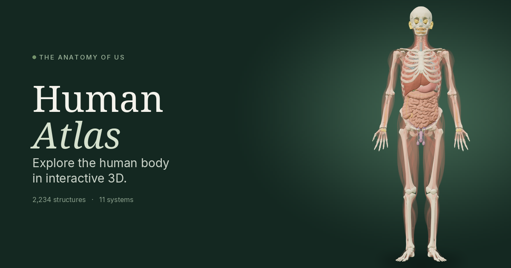

# Human Atlas

A small interactive anatomy site for curious people and students. Turn a real 3D body, peel back the systems, and see how the parts connect.

**Live site:** https://iraaikman.github.io/human-body-3d/



## What you can do

- Orbit, zoom, and pan an adult male reference body built from 2,234 BodyParts3D meshes.
- Show or hide eleven systems: skeletal, muscular, nervous, cardiovascular, respiratory, digestive, urinary, endocrine, lymphatic, reproductive, and integumentary.
- Search 3,432 structures by name or FMA id, then select one to read what it does and where that information comes from.
- Pull structures apart, or open a sagittal, coronal, or axial section.
- Follow four short guided tours, or try an eight-question quiz.
- Save the current view as an image. Keyboard controls cover search, reset, explode, and zoom.

It is a learning tool, not a clinical reference. The model is one adult male, and it does not show histology, a female body, or the full extent of nerves and lymphatics.

## How it was built

Human Atlas was built with help from AI coding tools. The site is static: HTML, CSS, and JavaScript in `docs/`, with Three.js and the anatomy meshes included. There is no build step. GitHub Pages serves it from the `main` branch, `/docs` folder.

Application code and the original writing are MIT. The 3D data is BodyParts3D, © The Database Center for Life Science, licensed under CC BY 4.0. See [ASSETS.md](ASSETS.md) for provenance.

## Run it locally

You need Node.js 20 or newer.

```sh
npm start
```

Open the localhost URL the server prints. Serve it over HTTP. Opening `docs/index.html` as a file will not load the model.

```sh
npm test
npm run check
```
