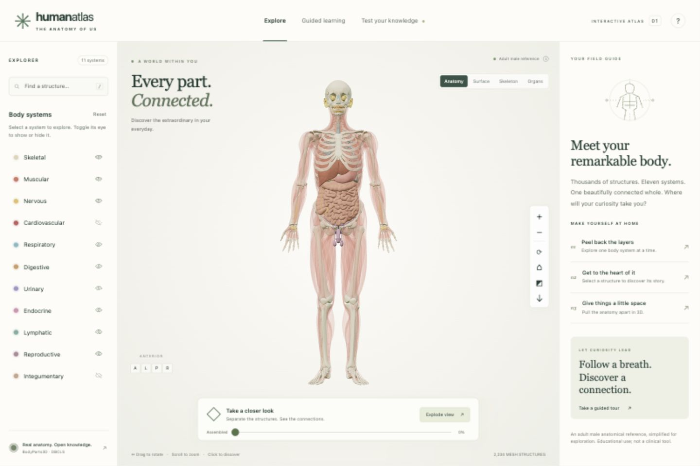

# Human Atlas

An interactive 3D anatomy explorer for general learners and students. It uses **2,234 real anatomical mesh components** and **3,432 searchable anatomical concepts** from BodyParts3D 4.0.

Rotate the body, reveal systems, isolate organs, pull structures apart, and follow short educational journeys. All application code and model assets are included. There is no build step, CDN requirement, API key, or backend.



## Run locally

Requires Node.js 20 or newer.

```sh
npm start
```

Open the localhost URL printed by the server. Do not open `docs/index.html` directly through `file://`; ES modules and model requests need HTTP.

```sh
npm test
npm run check
```

Tests verify every geometry bundle, checksum, mesh index and position, concept references, important system classifications, all tour and quiz targets, and search behavior.

## Explore

- Drag to orbit; scroll or pinch to zoom; right-drag or two-finger drag to pan.
- Select a system name to display that system. Eye controls independently toggle layers.
- Search thousands of structures and compound organs by name or FMA identifier.
- Select a structure to read its function and sources. Focus, isolate, or hide it.
- Use the explosion slider to separate structures. An isolated organ explodes around its own center.
- Open the section tool for sagittal, coronal, and axial surface cuts.
- Follow four guided journeys, or answer an eight-question quiz.
- Export the current 3D view as a PNG with source attribution.
- Keyboard: `/` search, `R` reset, `E` explode/assemble, `+`/`−` zoom, `Escape` clear selection.

The mobile layout places the information panel below the viewer and the system list behind the menu button. Search and system buttons offer keyboard-accessible alternatives to pointing at the 3D canvas. Reduced-motion preferences disable animated transitions.

## Put it on GitHub

The delivered ZIP is a clean, standalone repository source tree, without deployment identity or existing Git history. Unzip it, create an empty GitHub repository, and run inside the extracted project:

```sh
git init -b main
git add .
git commit -m "Add Human Atlas anatomy explorer"
git remote add origin YOUR_GITHUB_REPOSITORY_URL
git push -u origin main
```

A CI workflow runs the data-integrity tests and JavaScript syntax checks on pushes and pull requests.

The complete website is already in **`docs/`**, ready for GitHub Pages. After pushing the project, enable it once:

1. Open the repository's **Settings → Pages**.
2. Under **Source**, choose **Deploy from a branch**.
3. Select **main** and **/docs**, then click **Save**.

GitHub will publish the site and update it whenever you push changes to `docs/` on `main`. No install command, build step, or custom deployment workflow is needed. The included `.nojekyll` file keeps this a plain static site. Relative asset paths support a repository subpath. See [GitHub's publishing-source instructions](https://docs.github.com/en/pages/getting-started-with-github-pages/configuring-a-publishing-source-for-your-github-pages-site).

You can also serve `docs/` from any ordinary static HTTP host. Preserve `.bin.gz` files as gzip file payloads with `application/gzip`; do not set `Content-Encoding: gzip` on them, because the application explicitly decompresses those files. Normal HTTP compression for JavaScript, CSS, and JSON is fine.

## Project structure

```text
docs/
  index.html          Accessible application shell
  styles.css          Responsive layout
  app.js              UI, search, tours, quiz, and state coordination
  viewer.js           Three.js rendering, picking, explosion, sections, export
  catalog.js          Pure search and escaping helpers
  content.js          Original learning content with reference links
  assets/anatomy/     Catalog and compressed geometry bundles
  vendor/             Bundled Three.js 0.180.0 and OrbitControls
scripts/
  serve.mjs           Dependency-free local static server
  download-source.py  Download official source files for regeneration
  prepare-anatomy.py  Convert, label, group, quantize, and pack source geometry
tests/
  anatomy.test.mjs    Data integrity and learning-target coverage
```

## Scope and anatomical limitations

This is a functioning **macroscopic educational atlas**, not a complete digital twin of every aspect of a human. The source is a single adult male reference and does not include a female body, developmental stages, population variation, histology, cells, or molecular structures. Peripheral nerve and lymphatic coverage is limited; the available spinal-cord geometry is only a small represented segment. The app explicitly identifies these limits.

The source is the polygon-reduced BodyParts3D 4.0 dataset. Positions are quantized to 0.05 mm for smaller files. It contains about 6.68 million triangles and about 50 MB of compressed geometry; a modern browser with WebGL 2 and sufficient graphics memory is needed. Current Safari, Chrome, Edge, and Firefox support the browser APIs used. Performance varies on mobile devices.

Counts refer to mesh components, not independent organs. Compound concepts can include several tissue types. Display-system assignments are navigation aids; several organs serve multiple systems. Colors and exploded positions are illustrative. The section tool clips mesh surfaces without filling cut faces or generating tissue scans. Educational explanations describe the named organ or tissue class and do not constitute a physiology simulation or a clinically validated reference.

## Data and licenses

Application code and original educational copy: MIT. The 3D data has its own license.

**BodyParts3D, © The Database Center for Life Science licensed under CC Attribution 4.0 International.** The official archive updated its license in February 2025. See [ASSETS.md](ASSETS.md) for provenance, transformations, regeneration, and references. Three.js and OrbitControls are MIT-licensed; their license is bundled in `docs/vendor/THREE-LICENSE.txt`.

The app sends no analytics. Only the quiz's best score is saved in browser local storage. No user data is sent by the application to a server.
